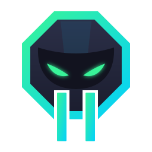
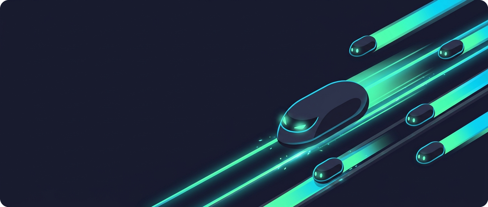

#%@# building..

<h1>
  
  RailBot
</h1>

  
  
  

  <strong>Sub-millisecond native Rust AI desktop &amp; web harness for local GGUF models and cloud endpoints.</strong> 
  Parallel micro-bots &nbsp;•&nbsp; Local-first speed &nbsp;•&nbsp; Zero-trust sandbox &nbsp;•&nbsp; Built on <code>rs-agent</code>

  

---

## Overview

**RailBot** (`rs-rail`) brings `rs-agent` into a single frameless native desktop and web surface running on `http://127.0.0.1:24243`, letting autonomous micro-bots collaborate in parallel across local `llama-server` and cloud models.

- **Frameless Native App:** Launch with `rail` or `rr`
- **Live Collaborators:** Consult peer micro-bots read-only via `/call`
- **Custom Themes:** `Dark Default`, `Omarchy`, `Noctalia`, and custom JSON palettes

---

  <a href="LICENSE">MIT License</a>

