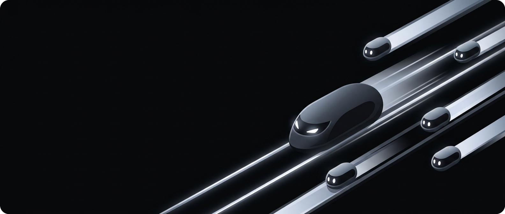

<div align="center">

<h1>
  
  RailBot
</h1>

<p>
  <a href="https://github.com/j5onrf/railbot/releases"></a>
  <a href="https://github.com/j5onrf/railbot"></a>
  <a href="https://github.com/j5onrf/railbot/blob/main/LICENSE"></a>
  <a href="https://j5onrf.github.io/railbot/"></a>
</p>

<p>
  <strong>Native Rust desktop &amp; web UI built on <a href="https://github.com/j5onrf/rs-agent">rs-agent</a> for local GGUF and cloud models.</strong><br />
  Parallel micro-bots &nbsp;&middot;&nbsp; One-turn <code>/sub</code> agents &nbsp;&middot;&nbsp; Zero-trust sandbox &nbsp;&middot;&nbsp; Single binary
</p>

<p>
  <a href="https://j5onrf.github.io/railbot/">
    
  </a>
</p>

### <a href="https://j5onrf.github.io/railbot/">Launch Interactive Web Demo &rarr;</a>

</div>

---

## Highlights

- **Single Native Binary:** Web/desktop UI compiled right in (`ui.html`).
- **Frameless Desktop App:** Opens via Chrome/Brave/Chromium `--app=` mode, Omarchy, or `railbot.desktop`.
- **Parallel Micro-Bots (`/call`):** Consult peer micro-bots read-only via `/call`.
- **One-Off Sub-Agents (`/sub`):** Injects `delegate_task` for one turn (`0t` overhead otherwise), clamped to depth `1`.
- **Zero-Trust Sandbox:** Composer shield toggles **Zero Trust** vs **Allow All** (`.env` locked).
- **Themes & Desktop Sync:** Live Omarchy/Noctalia sync, `+ Noctalia` catalog browser, and custom JSON palettes (`eldritch`, `darkbot`, `claude`).
- **Built on [rs-agent](https://github.com/j5onrf/rs-agent):** Listens on `http://127.0.0.1:24244` (`RAILBOT_PORT` in `.env`); see [rs-agent](https://github.com/j5onrf/rs-agent) for core engine.

---

## Quickstart

```bash
git clone https://github.com/j5onrf/railbot.git ~/.config/railbot
cd ~/.config/railbot
cargo build --release
./launch.sh
```

Launch options:
- `./launch.sh` — opens standalone frameless app window
- `./launch.sh web` — opens in your default browser
- `./launch.sh [path]` — opens workspace folder directly

---

<div align="center">
  <a href="LICENSE">MIT License</a>
</div>
